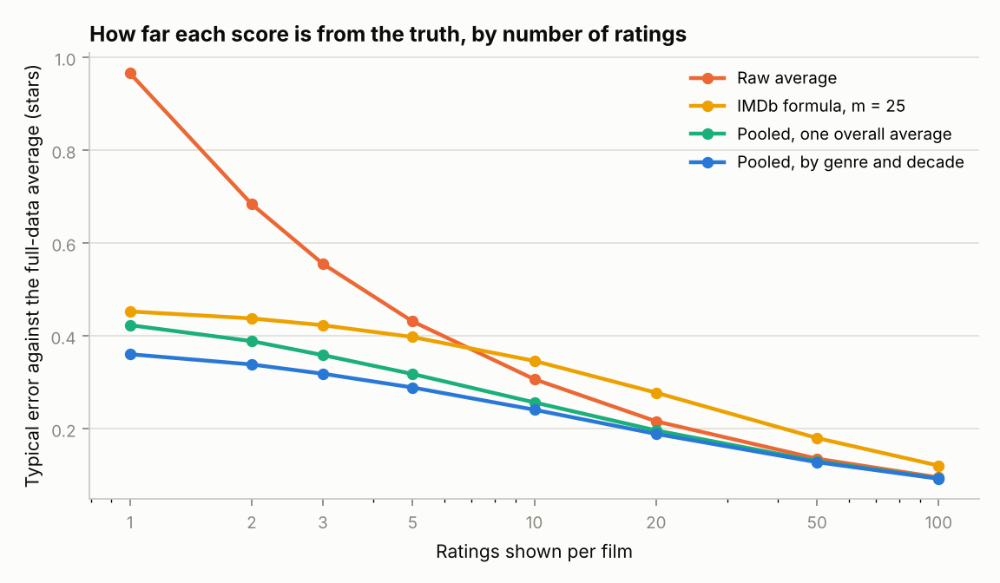

# Fair film scores

[](https://github.com/jackcormacwright1/fair-film-scores/actions/workflows/tests.yml)

Sorted by average rating, the best films in MovieLens are all films rated once, by someone who gave them
five stars. Half of the 84,432 rated films have five ratings or fewer. This project scores every film in
MovieLens 32M (32 million ratings by 200,948 people) in a way that allows for **how many** ratings each film
has and **whose** they are, and tests each scoring method against a known answer.

It uses the same partial pooling as the case-duration model in
[theatre_scheduler](https://github.com/jackcormacwright1/theatre_scheduler): a film with few ratings is pulled
towards what its genre, decade and number of ratings predict, by an amount estimated from all films together.
For ranking it uses each film's uncertainty, as the theatre scheduler books lists to an overrun risk rather
than to the average. Some people rate everything high and others low; adjusting for that is the equivalent of
the theatre model's surgeon effect. And like
[bed-demand-model](https://github.com/jackcormacwright1/bed-demand-model), every method is checked against a
known truth.

## Headline findings

The test: the 4,397 films with at least 1,000 ratings have an all-but-certain average. Each is shown only a
few of its ratings, and each method's estimate is compared with the full average. Everything a method learns
from other films comes from a separate half of the films.



1. **Pooling cuts the error from few ratings by up to two-thirds.** With one rating, the pooled score's
   typical error is 0.36 stars against 0.97 for the raw average; with five ratings, 0.29 against 0.43. By 100
   ratings all the scores agree. Its 90% intervals contain the true average 90% of the time.
2. **A fixed formula has to guess, and the guess matters.** The IMDb-style formula adds *m* imaginary ratings
   at the overall average. The best *m* was 5; the model estimates its equivalent from the data as 4.2,
   without tuning. A conventional-looking *m* = 25 is worse than the raw average once a film has between five
   and ten ratings ([chart](results/fixed_m.png)).
3. **The best estimate is not the best ranking.** With realistic numbers of ratings, the raw average's top 20
   are all single five-star ratings: their true average is 3.66 and a quarter are below the median film. The
   pooled score does far better, but its top films are those whose few ratings happened to be strongest, so
   it overrates them by 0.09 to 0.21 stars. Ranking by the **lower bound** (the score we are 90% sure a film
   reaches) picks the best films of any method (true average 4.16) and promises slightly less than it
   delivers. For the top 100, 86% of its picks are truly in the best 10% of films, against 76% for the
   formula with *m* = 25.
4. **Who rated a film matters almost as much as the film.** Users' habits vary by 0.44 stars, films by 0.48.
   Taking each rater's habit out before pooling cuts the error in estimating how an average rater would score
   a film by 14% with five ratings and by 39% with fifty.

The model, the tests and their limitations are written up in [docs/METHODOLOGY.md](docs/METHODOLOGY.md). Full
results are in [results/](results/), including the top 15 films under each way of ranking
([catalogue_top.md](results/catalogue_top.md)).

## The dashboard

`streamlit run app.py` opens a dashboard over all 84,432 films:

* **Top films:** rank by the raw average, a minimum number of ratings, the IMDb formula (choose *m*), the pooled
  score or its lower bound, with or without the rater adjustment, filtered by genre and year.
* **Look up a film:** its raw average, prediction, pooled score and lower bound, the arithmetic behind them,
  and how the score would move as ratings accumulate.
* **Does it work?** and **Methodology:** the test results and the write-up.

## Run it yourself

```bash
pip install -e ".[dev,app]"
pytest                                       # 17 tests on a synthetic catalogue with known answers

# MovieLens 32M is downloaded from GroupLens, not stored here (239 MB)
mkdir -p data
curl -o data/ml-32m.zip https://files.grouplens.org/datasets/movielens/ml-32m.zip

python scripts/run_evaluation.py             # the known-answer tests: about 10 minutes, writes results/
python scripts/build_app_data.py             # scores every film for the dashboard: about a minute
streamlit run app.py
```

## Layout

```
src/filmscore/
  data.py        loading MovieLens, per-film counts, averages and variances
  scores.py      the pooled model: priors, the grid posterior of tau, each film's posterior, the IMDb formula
  raters.py      the rater model: film and user effects
  evaluate.py    the known-answer tests
  synthetic.py   a synthetic catalogue with known true scores, for the tests
scripts/         run_evaluation.py, build_app_data.py
app.py           the Streamlit dashboard
app_data/        the per-film table the dashboard reads (derived from MovieLens; see its README)
results/         test results and charts
docs/            METHODOLOGY.md
```

## Data

This project uses the **MovieLens 32M** data set: F. Maxwell Harper and Joseph A. Konstan (2015), *The MovieLens
Datasets: History and Context*, ACM Transactions on Interactive Intelligent Systems 5(4), 19,
https://doi.org/10.1145/2827872. It is used for research purposes under the MovieLens licence. The derived
table in `app_data/` is redistributed under the same conditions, set out in
[app_data/README.md](app_data/README.md). Neither the University of Minnesota nor GroupLens endorses this
project.

The code is MIT licensed.
